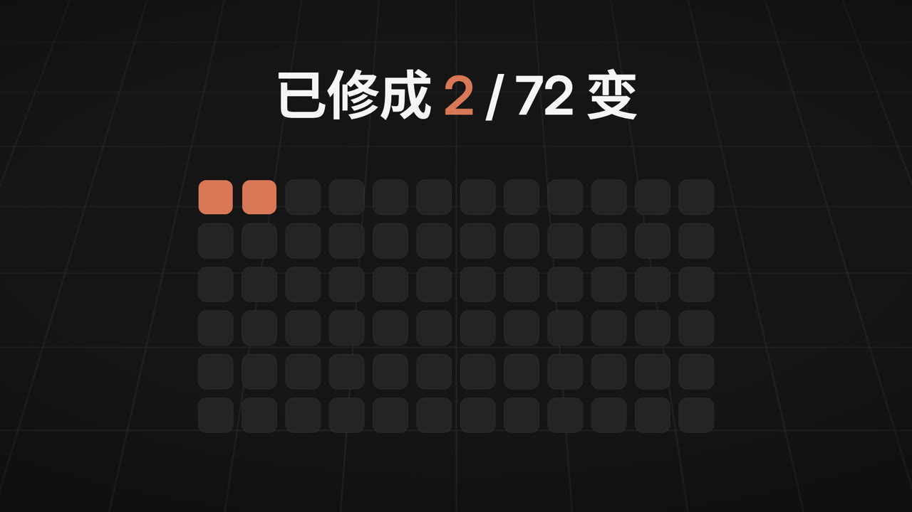

# wukong-animation · 代码七十二变

> 讲一个故事，助手帮你拍成一支动画短片。
> 每一帧画面都由代码"画"出来，不用任何 AI 视频生成模型。

<!-- progress -->
**已修成 2 / 72 变**
<!-- /progress -->

## 它能帮你做什么

你只需要用一句话说出想拍什么，比如"一个关于秋天离别的水墨短片，20 秒"。
助手会像一位导演一样，陪你从构思一路做到成片：

- **出方案**：根据你的故事推荐几套画风，你挑一套；
- **写脚本、画分镜**：先给你看文字脚本和分镜，你满意了再往下做；
- **配声音**：可以用你自己录的旁白，也可以用 AI 配音，再配上音乐；
- **出成片**：输出 MP4 视频（也可以导出 GIF）。

每到关键环节，Claude 都会**停下来请你过目**，你说"可以"才继续；不满意就直接说哪里要改。

## 开始之前，你需要准备

1. **桌面执行环境**：Claude Code、Codex，或支持本地插件和本地执行的 ChatGPT 桌面环境。需要能运行终端命令、读写所选工程目录；ChatGPT 网页 / 手机端不在本次支持范围内。
2. **Node.js 20 或更高版本**：[nodejs.org](https://nodejs.org/) 下载安装即可。
3. **ffmpeg**（用于生成视频和处理声音），在终端里运行对应命令安装：

| 系统 | 安装命令 |
|---|---|
| macOS | `brew install ffmpeg` |
| Windows | `winget install ffmpeg` |
| Ubuntu | `sudo apt install ffmpeg` |

下面几样不装也能用，装了体验更好：

| 工具 | 有什么用 | 安装方式 |
|---|---|---|
| git | 每次你确认一个环节，都会自动存一个版本，改坏了可以随时退回 | [git-scm.com](https://git-scm.com/) |
| fonttools | 让中文字体文件更小，渲染更快 | `pip install fonttools brotli` |
| edge-tts 或 kokoro | 没有自己录音时，用 AI 生成旁白 | `pip install edge-tts` |

> 不确定装好了没有？装完插件后，对 Codex / ChatGPT 说「用 wukong-animation 检查并配置环境」；Claude Code 运行 `/wukong-animation:setup`。它会逐项检查，并告诉你还缺什么、怎么装。

## 安装

### Codex / ChatGPT 桌面本地环境

插件包含通用 Agent Plugins 清单、Codex 兼容清单和 `film`、`setup`、`styles` 技能。ChatGPT 桌面端需要使用能访问本地终端与文件的执行环境；安装插件不会自动赋予本地执行能力。

在终端运行：

```bash
codex plugin marketplace add wukongnotnull/wukong-animation
codex plugin add wukong-animation@wukong-animation
```

第一行添加来源，第二行安装并启用插件；需要提供 `codex plugin` 命令的 Codex 版本。也可在桌面端的插件目录中选择 `wukong-animation` 来源，安装并启用同名插件。安装后打开新聊天；若桌面端还没发现本地来源，重启应用后再检查。

改动尚未发布时，从一份包含本次改动的**干净副本**试装，把第一行换成 `codex plugin marketplace add /绝对路径/wukong-animation`；不要直接从含示范片成片与本机依赖的开发目录安装。干净副本的准备方式见 [贡献指南](docs/CONTRIBUTING.md#桌面插件本地试装)。

安装后先选择插件的「设置」入口，或发消息：

```text
用 wukong-animation 检查并配置本地制作环境
```

设置成功后，选择作品要保存的工程目录，再说：

```text
用 wukong-animation 拍一支关于秋天离别的水墨短片，20 秒
```

浏览画风可以说「用 wukong-animation 推荐适合产品发布的动画风格」；继续制作可以说「用 wukong-animation 继续这个目录里的片子」。这些入口通过 skills 提供，不依赖 Claude 的斜杠命令。

### Claude Code

打开 Claude Code，依次输入下面三行（每行回车一次）：

```
/plugin marketplace add wukongnotnull/wukong-animation
/plugin install wukong-animation@wukong-animation
/wukong-animation:setup
```

- 第 1 行：添加插件来源；
- 第 2 行：安装插件；
- 第 3 行：下载渲染需要的浏览器内核和依赖包（放在 `~/.wukong-animation/` 里，以后升级插件不用重新下载）。

第一次运行 `setup` 需要下载一些文件（依赖包约 230 MB，另有浏览器内核），请耐心等它完成。

### 其他 Agent 工具

Cursor、Copilot、Gemini CLI、OpenCode、Roo Code 等工具使用同一份完整技能包，引擎和风格随包安装。下载 [v0.19.0 发布包](https://github.com/wukongnotnull/wukong-animation/releases/tag/v0.19.0) 里的 `wukong-animation-agent-skills-v0.19.0.zip` 和 `SHA256SUMS`。安装、更新、卸载及逐平台验证边界见 [Agent 安装指南](docs/agent-installation.md)。

## 拍你的第一支片

在 Claude Code 里输入：

```
/wukong-animation:film 一个关于秋天离别的水墨短片，20 秒
```

后面的话换成你自己的故事就行。没想好也可以只输入 `/wukong-animation:film`，助手会先问你想拍什么。

### 整个过程是什么样的

助手会带你走一遍完整的制作流程，在下面 12 个节点停下来等你确认（没有副版的片子跳过 ⑪）：

| 节点 | 你会看到什么 | 你要做什么 |
|---|---|---|
| ① 制作简报 | Claude 先一轮轮问清片子拿去做什么、讲什么、多长、什么画幅，再整理成一份简报 | 看要求写得对不对 |
| ② 美术定调 | 几套画风方案 | 选一套 |
| ③ 剧本 | 故事脚本 | 看内容对不对味 |
| ④ 分镜 | 每个镜头拍什么、多长 | 看节奏和镜头安排 |
| ⑤ 旁白来源 | 询问用你的录音还是 AI 配音 | 选一种；用自己的录音就把文件交给助手 |
| ⑥ 声轨 | 旁白 + 配乐的试听 | 听一听 |
| ⑦ 风格帧与动态分镜 | 每个镜头的关键画面，以及一段粗略的预览视频 | 看画面和声画是否对得上 |
| ⑧ 字幕 | 字幕文件和字幕排版样张 | 看有没有错字、断句是否合适；不要字幕就说不要 |
| ⑨ 小样 | 低清版完整短片（有字幕时带字幕） | 看整体效果和字幕位置 |
| ⑩ 终审 | 高清成片 | 确认交付 |
| ⑪ 改版审片 | 简报里要了横竖两版时，用同一套镜头排出的另一种画幅，以及一份「主版有没有被改动」的报告 | 看另一版排得好不好 |
| ⑫ 剪映草稿 | 询问要不要剪映草稿；要的话直接出现在你的剪映里 | 不需要就说不要；需要就在剪映里打开看看 |

需要你选择或签批的地方，助手会使用当前宿主支持的选择卡片；工具不可用时会列出文字选项，等你明确回复。想说得更具体，可以直接补充意见。在任何一个节点，你都可以直接说出修改意见，比如"第二个镜头再慢一点""山的颜色淡一些"，助手会改好再给你看。

### 成片在哪里

所有作品都存在你当前所在目录下的 `films/<片名>/` 文件夹里，成片是其中的 `.mp4` 文件。有字幕时文件名会标明：`_有字幕.mp4` 是字幕画在画面上的版本，`_无字幕.mp4` 是干净画面，`_字幕.srt` 是单独的字幕文件。制作过程中请你审听、审看的文件都放在 `review/` 文件夹里：声轨、音色试听、接触表、动态分镜、小样、字幕预览，Claude 每次都会给出完整路径。

### 做到一半关掉了怎么办

没关系。下次在**同一个目录**里说「用 wukong-animation 继续制作」（Claude Code 也可输入 `/wukong-animation:film`），助手会发现在制的片子，问你是接着做还是新开一支。

## 72 种风格

目前已经可以使用的是**加粗**的风格，其余正在陆续制作中。

<!-- gallery -->
| 分类 | 风格（加粗 = 已可用） |
|---|---|
| 东方神韵 | **水墨写意** · 工笔重彩 · 敦煌壁画 · 皮影戏 · 剪纸 · 木版年画 · 青花瓷 · 走马灯 · 书法笔势 |
| 手绘绘画 | 铅笔速写 · 水彩晕染 · 油画厚涂 · 蜡笔童趣 · 粉笔黑板 · 炭笔素描 · 点彩派 · 浮世绘 · 丝网版画 |
| 平面排版 | 瑞士国际主义 · 包豪斯几何 · 动态字体 · 构成主义海报 · 孟菲斯 · 极简线条 · 拼贴 · 杂志版式 · 霓虹招牌 |
| 卡通漫画 | 赛璐璐动画 · Q 版萌系 · 橡皮管卡通 · 漫画分镜 · 小人书连环画 · 表情包贴纸 · 火柴人 · 黏土定格 · 纸偶动画 |
| 游戏数字 | 8-bit 像素 · 16-bit RPG · 等距视角 · 低多边形 · 体素 · 赛博朋克 HUD · 复古街机 CRT · ASCII 代码雨 · 蒸汽波 |
| 电影年代 | 黑白默片 · 70 年代胶片 · 黑色电影 · 90 年代港片霓虹 · 西部宽银幕 · 老新闻片 · 武侠片 · 科幻片头 · 公路片 |
| 材质 3D | 玻璃折射 · 液态金属 · 毛毡 · 折纸 · 粒子 · 流体 · 光线行进抽象 · 晶体宝石 · 积木 |
| 信息叙事 | 数据可视化 · 产品发布 · 科普讲解 · 地图路线 · 时间线 · 白板讲解 · **发布会 Keynote** · 纪录片字幕 · 竖屏短视频 |

<table>
<tr><td align="center"><br>水墨写意</td><td align="center"><br>发布会 Keynote</td></tr>
</table>
<!-- /gallery -->

想看每种风格适合拍什么，可以说「用 wukong-animation 查看动画风格，推荐适合古诗的画风」；Claude Code 也可输入 `/wukong-animation:styles 古诗`。

库里没有你想要的风格？直接跟助手说"帮我新建一个风格"，它会引导你做一个属于自己的风格，以后可以反复使用。

## 常用命令

下表是 Claude Code 命令。Codex / ChatGPT 桌面端直接描述相同需求，分别使用插件的 `film`、`styles`、`setup` 技能。

| 命令 | 作用 |
|---|---|
| `/wukong-animation:film [故事]` | 开拍一支新片，或继续在制的片子 |
| `/wukong-animation:styles [关键词]` | 查看所有风格，或按关键词推荐 |
| `/wukong-animation:setup` | 安装 / 检查运行环境 |

## 常见问题

**需要会写代码吗？**
不需要。代码由助手来写，你只负责讲故事和提意见。

**会用到 AI 视频生成吗？**
不会。所有画面都是代码一帧一帧绘制的，所以同一份工程每次渲染出来的结果完全一样，改一个镜头也只需要重新渲染那一个镜头。

**修改一镜也要整片重渲吗？**
日常先看静帧或局部小样，完整预览和终稿在你明确要求时生成。小样最多 960 长边、15fps，默认低并发；终稿保持原定画质。未改镜头和已验证的相同片段会复用，每镜保留最新小样与高清缓存。需要空间时告诉助手清理可再生渲染缓存，不要自行删除整个 `.cache`。

**字体下载失败怎么办？**
字体会自动从 GitHub 或 jsDelivr 下载。如果两个都连不上，可以设置环境变量 `WKA_FONT_MIRROR`，指向一个与 [google/fonts](https://github.com/google/fonts) 目录结构相同的镜像地址。

**想要竖屏视频？**
在开拍时告诉 Claude "做成竖屏（9:16）"即可。

**做出来的片子版权归谁？**
归你。

## 许可

- 代码与文档：MIT
- 示范片、风格帧：CC BY 4.0（见 `LICENSE-MEDIA`）
- 你用 wukong-animation 做的片子归你所有
- 发布会 Keynote 等用 remotion 管线渲染的风格依赖 [Remotion](https://www.remotion.dev/license)：个人和不超过 3 人的公司免费，更大的公司需要向 Remotion 购买公司授权

## 开发者与贡献者

想了解实现原理或参与贡献：

- 架构说明：[docs/ARCHITECTURE.md](docs/ARCHITECTURE.md)
- 完整制作流程（15 道工序）：[plugin/skills/director/SKILL.md](plugin/skills/director/SKILL.md)
- 贡献新风格：[docs/CONTRIBUTING.md](docs/CONTRIBUTING.md)
